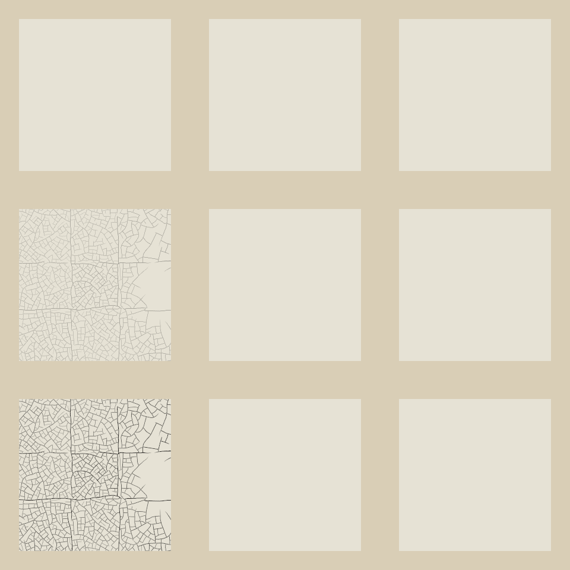

# RFC: traction cracks over paint that has not dried through

Proposal for discussion, with an exploratory study from
[ai-painting](https://github.com/davidfwatson/ai-painting/tree/b9dfeb2).
Prepared against upstream `04cc795`. Agent-written with OpenAI Codex.
Related: [ai-painting issue 5](https://github.com/davidfwatson/ai-painting/issues/5).
This draft adds only a proposal and manual diagnostic evidence; it does
not enable new paint behavior.

A thin, faster-setting top coat over a thick, still-soft undercoat could
part into islands during drying, exposing the paint underneath. The fork
has a prototype of this behavior in `defects.rs`, reusing upstream's
`crack::network`. The examples below show both the useful effect and
reasons to resolve the design before porting it.

This proposes **traction crackle**, one of the omissions in
[notes/cracks.md](../cracks.md). It does not implement the separate
single-film critical-thickness cracking described there, nor the wrinkles
or gravity/drips in the fork. The fork's engine 6 is its own version; an
upstream engine number is for the maintainer to assign.

## Example and controls



Columns, left to right: prototype over a soft undercoat; prototype over
the same undercoat after three additional simulated years; engine 5 over
the soft undercoat. Rows, top to bottom: one hour after applying the
top coat, after five days, after sixty days. Each square is a 320 px
render of an 80 mm canvas. The underlying patch is 200 µm of dark paint
with stiffness 0.30 and relative drying rate 0.5, waited 32 days; the top
patch is 25 µm of light paint with stiffness 0.80 and drying rate 2.0.

These are deliberately uniform films inserted directly into the wet
layer, rather than a painting replay or a brush demonstration. The canvas
is flat, with no solvent, raw-cloth staining, linen, varnish or finishing
craquelure. At these parameters the prototype's wrinkle severity is zero.
The sheet uses `seen()` without `dry()` or `save()`, so observing a panel
does not advance its clock. The probe prints measured state and writes
[observations.csv](observations.csv) and [comparisons.csv](comparisons.csv);
these observations are not goldens or approved expected answers.

The prototype is heuristic. Its 30 µm softness threshold, `THROUGH = 6`
hardening factor, 30-day opening time constant and 1.6 mm finest islands
are estimates. [Bury and Bratasz (2024)](https://www.nature.com/articles/s40494-024-01493-x)
distinguish drying and aging mechanisms, but do not calibrate this
soft-undercoat rule. [Janas et al. (2022)](https://www.nature.com/articles/s40494-022-00814-2)
measure long-term shrinkage and embrittlement; those results do not
establish the prototype's onset or opening times.

## Gaps reproduced before proposing a port

- **First `dry()`:** on a fresh canvas the fork can bake the undercoat
  before its per-pixel drying clock exists, skipping the softness record.
  `wait(0); dry()` initializes that record. A production model must give
  the same layer history for both paths.
- **Wait partitioning:** one long wait can harden the undercoat before
  deciding whether the top coat cracks. Splitting the interval can record
  the cracks earlier, leaving permanent gaps. This changes whether damage
  happens, beyond rounding differences. Crack initiation must use the
  substrate state at the actual setting time.
- **Material history:** the prototype uses stiffness as a proxy for oil
  content despite the engine's separate oil property. Opening changes
  color and height while leaving stored film thickness, gloss and
  absorbency intact. Overpainting and later material operations need
  consistent layer semantics.

Thread-count and checkpoint comparisons in the probe are narrow checks
of the same small scene. The checkpoint is taken with active, visibly
opening cracks. Passing those comparisons cannot cure the lifecycle or
physical-model gaps above. See [REPORT.md](REPORT.md) for the recorded run
and existing-log checks.

## Suggested implementation boundary

If traction crackle is wanted first, keep its first implementation to
through-drying plus crack initiation/opening. Use upstream's drying and
checkpoint conventions, with a new engine gate and format for its state;
preserve engines 1–5 and historical checkpoint writes. The fork's `Fork`
and `DWFORK01` format also carry gravity and staining and should not be
imported. Reuse the network geometry, with physical coordinates and a
rebuildable spatial cache; the public `Canvas::crack` applies finishing
damage and calls `dry()`, so it is not the early-drying hook.

Before enabling it, verify first-layer `dry()`, waits across setting
transitions, hand-time aging, active-crack checkpoint continuation,
overpainting, oil variation independent of stiffness, crop coordinates,
thread determinism and finite/bounded state. Existing-log and checkpoint
checks must remain unchanged. Decide what retained thickness means after
lifting or wiping paint; the cumulative film counter is not layer history.

Would traction crackle be useful as the first slice, or should single-film
thick-paint cracking come first? For an implementation, which engine
number and automatic-versus-opt-in behavior would fit the project?

## Reproduce the exploratory study

Use a local clone of the public fork containing the commit pinned below,
plus Rust, a C compiler and Python 3 (for `lockrun`). These
commands create a disposable snapshot; they do not modify that clone or
upstream's engine. Run in Bash or Zsh from the upstream repository root. The fork's MIT
code and existing dependencies are used; no image model is involved.

```sh
set -e
set -o pipefail
FORK_REPO=/path/to/ai-painting
study="$PWD/notes/drying-cracks"
runner="$PWD/scripts/lockrun"
work=$(mktemp -d "${TMPDIR:-/tmp}/drying-cracks.XXXXXX")
git -C "$FORK_REPO" archive b9dfeb2ab185b2a50bed5ca18c89bc172e20e1f2 \
  Cargo.toml Cargo.lock .cargo crates | tar -x -C "$work"
cp "$study/probe.rs" "$work/crates/paint/src/issue5_probe.rs"
cat >> "$work/crates/paint/src/defects.rs" <<'RUST'

#[cfg(test)]
#[path = "issue5_probe.rs"]
mod issue5_probe;
RUST
(
  cd "$work"
  ISSUE5_OUT="$work/results" CARGO_TARGET_DIR="$work/target" \
    "$runner" --timeout 600 -- cargo test --locked -p paint --lib \
    defects::issue5_probe::study -- --exact --nocapture
)
```

Inspect `$work/results`, then copy any results to keep and remove `$work`.
The manual probe is outside the upstream test suite and changes no
production code, test lists, baselines or expected answers.
