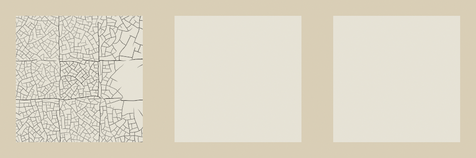

# Traction cracks over a still-soft undercoat

Working port from upstream main `ea33747d6fea14055223809f47375b130c6a589e`.
Written by a Codex agent and independently reviewed by other agents.

A fast-setting top film can part over a thick undercoat that is touch-dry but
still soft beneath. This contribution covers that traction-crack case only.
Wrinkles and gravitational paint flow remain separate later work. The rates,
thresholds and opening scales are estimates inherited from the fork; this is
an artistic material model, not a calibrated fracture simulation.

The provisional engine number is centralized in `traction::ENGINE` (6). New
sessions record it; existing logs keep their recorded engine or historical
fallback. All traction allocations and drying hooks are gated to the new
engine. Geometry uses the existing `crack::network`, indexed in physical
whole-canvas coordinates and cached by size and support seed.

Films record their gel and touch-dry dates before aging. Softness and crack
opening use fixed absolute time origins, retaining cracks that formed while
the undercoat was soft even when one wait ends years later. Openings reach a
fixed final width at maturity, so the last observation cannot freeze a different
width. Fresh paint retires a covered opening before the next aging step; later
surface edits also retain ownership of the pixels they change.

Cracks expose the captured underlying color, relief, paint film, gloss and
absorbency. The undercoat height is captured before leveling bridges its relief.
First `dry()` records substrate softness as `wait()` does, and finalizes
touch-dry roundoff. Wait partitions agree within the specified f32 tolerances;
checkpoint continuation and thread-count comparisons are exact.

Published box presets retain their engine-5 declaration and exact tube table.
Material acceptance checks that use those presets retain that engine; the
traction tests explicitly select the new engine.
The Easel explicitly selects the current engine for new paintings and the
recorded engine for old logs. Custom palettes retain their current-engine
default. The replay-only palette digest test is gated on `replay`, repairing
the pre-existing bare painter test compilation error without changing its
replay coverage. New-session header and checkpoint format tests now check the
new engine's metadata.

## Checkpoints and compatibility

New-engine checkpoints use `PAINTC13` (primed) or `PAINTC14` (raw cloth), appending
a versioned traction section to the existing material payload. It stores fixed
softness origins and typed crack indices, surfaces, geometry and dates. The
reader validates lengths, indices, order, finite values, dates, engine/format
pairing and trailing data. The geometry cache is rebuilt after restore.

Engines 1–5 retain their existing checkpoint layout and drying calculations.
No protected file, tube fixture or golden answer was modified. In particular,
`state_dump.rs` remains unchanged. Its named-field projection does not include
the new traction state; full checkpoint round trips and checkpoint-based easel
state digests cover that state instead. The fork's `DWFORK01` format is separate
and is not imported.

The two prototype bugs were filed and fixed in
[ai-painting#10](https://github.com/davidfwatson/ai-painting/issues/10),
[ai-painting#11](https://github.com/davidfwatson/ai-painting/issues/11), and
[PR #12](https://github.com/davidfwatson/ai-painting/pull/12) before this port.

## Evidence

The synthetic study is generated by the actual port's
ignored `traction::tests::write_traction_study` test. It uses direct uniform
films on an 80 mm canvas: 200 µm dark undercoat (stiffness 0.3, drying 0.5),
then 25 µm light topcoat (stiffness 0.8, drying 2). The hardened control waits
three extra years before the topcoat; the engine-5 control uses the same films.
This diagnostic isolates drying behavior and is not a whole painting replay.

Only the engine assignment remains an integration question.



Left: still-soft undercoat; center: hardened undercoat; right: engine 5.
At 60 days the 320 px study's dark-pixel shares are 0.14775988, 0 and 0;
mean linear luminance is 0.64947033, 0.75960767 and 0.75960767. Full settings
are in [measurements.csv](evidence/measurements.csv). Individual images are
[soft](evidence/soft-undercoat.png),
[hardened](evidence/hardened-undercoat.png) and
[engine 5](evidence/engine-5.png).

## Validation

macOS arm64, rustc 1.97.1, repository build profiles and fixed Lua hash seed.
Every heavy job used the unchanged machine-wide `scripts/lockrun`.

| Check | Result |
| --- | --- |
| `scripts/test --all`, engine commit `bc14cf3` | Completed: 29 steps, 1,110 runner-reported checks; exit 4, known rag failures only; 662.5 s |
| Final `scripts/test`, commit `002fc74` | Completed: 12 steps, 456 checks; exit 4, known rag failures only; 202 s |
| Replay release build | Passed in both gates |
| `cargo build --locked -p easel --no-default-features` | Passed |
| `cargo test --locked -p easel --no-default-features` | 102 passed, 1 ignored |
| Paint traction/checkpoint tests, `--no-default-features` | 14 passed, 1 ignored study |
| Port's explicit study writer | 1 passed; PNGs/CSV generated |
| Current-main versus candidate old-log capture | All 11 PNGs and state digests byte-identical; each binary's repeated output identical |
| Updated-main Studio Python tests | 73 passed |
| Updated-main Studio headless Chrome checks | Gallery passed all 4 view combinations; replay passed 9 groups / 42 main comparisons, no page errors |

The only contribution code change after the full gate is a feature guard and explanatory
comment on an existing historical-globals **test**. The final fast gate and
bare painter tests cover that guard; production engine code is unchanged.
The evidence commit adds reports and images only. Upstream main subsequently
advanced from `b4f9c4e` to `ea33747`; those six Studio-only file changes were
merged into the contribution branch. The `crates`, `Cargo.toml`, `Cargo.lock`
and `.cargo` Git objects are identical on both main revisions. The tested
engine commits remain in the merge history. Updated Studio tests and refreshed
replay captures are recorded below, with explicit binary build provenance.
The refreshed capture is bound to clean merge commit `1a3d97d`; the final
receipt update and capture-helper CSV line-ending correction change no engine
or Studio code. The [validation archive](evidence/validation-receipts.zip) contains
`all-checks.json` and `fast-checks.json`, recording revisions, clean-tree status,
individual commands, counts, timings and log hashes. It also contains the
baseline/control logs, the resumed painter/study/replay checks, and the
current-main Studio check manifest, input hashes and three logs. The Chrome
checks use synthetic browser transports/images; they replay no paintings.

Normal tests cover soft/hardened/engine-5 controls, first `dry()`, fractional
and ten-year waits, nonuniform films and recoating, exact checkpoint
continuation and 1/4-thread equivalence, crop coordinates, cache size/seed
changes, textured undercoat relief and all material endpoints, glaze/varnish
ownership, and malformed new checkpoint sections. A separate gel-rounding
regression failed before clamping the gel date and passes afterward. Surface
partition tolerances are 0.00002 for RGB/film/gloss/absorbency and 0.002 µm for
height; softness origins agree within 0.0002 µm and dates within 0.02 minutes.
These are small f32 differences, not permission for waits to suppress damage.

### Known failures, reproduced on main

The full gate is **not all green**. `cargo-test` fails only
`rag::tests::a_dry_rag_leaves_a_pale_tint_and_spirits_lift_nearly_to_the_ground`:
the spirits tuple is
`(0.9744869296698226, 0.8993446396277543, 0.9429845376359838)`;
the hollow-film share misses the required `> 0.9`. The exact same tuple was
reproduced on untouched main `b4f9c4e` (whose engine/build inputs are identical
to current main `ea33747`); `main-rag.log` in the validation archive
is retained. `baseline-state` and `thinner-all` report the related known
historical rag baseline mismatch; unchanged main's baseline check also fails.
The final fast gate's `thinner-quick` reports that same mismatch. Every other
required step passes. No rag assertion or expected answer was changed.

### Pre-existing painter test configuration defects

Untouched main's bare painter tests first fail to compile: the default-box
`a_palette_look_changes_nothing` test references replay-only
`state_digest_line` (four E0425 errors). The port gates this test on `replay`;
`main-painter-compile.log` in that archive is retained.

With only that compile repair, main's
`api::draw_rag::tests::an_older_log_sees_the_globals_it_saw` fails in the bare
build: 66 globals / hash 415863763 versus the historical 69 / 602616302.
The historical build included `varnish`, `cracks` and `relief`; these are owned
by the `finish` feature. Enabling only `finish` makes the same exact test pass
on main. The port therefore gates this historical fingerprint on `finish`,
without changing its answer. This also handles replay-without-finish builds
correctly. The independent control report, bare failure and finish-only pass are retained
as `painter-control-*` files in the validation archive. The
control worktree contained no port code and was removed afterward.

### Exact old-log evidence

[old-log-comparison.csv](evidence/old-log-comparison.csv) records matching
before/after PNG and state-digest SHA256 for all 11 existing cases. The
[main manifest](evidence/main-manifest.json) binds the independent unchanged
`ea33747` capture; the [candidate manifest](evidence/candidate-manifest.json)
binds the clean merged contribution, input hashes, compiler and executable hashes.
Both captures reuse the already-tested release binaries: main built from
`b4f9c4e`, candidate from `002fc74`. The [build provenance](evidence/build-provenance.json)
records identical Git objects for every engine/build input across the respective
Studio/documentation-only updates. No rebuilt binary is claimed.
[old-log-replays.zip](evidence/old-log-replays.zip) includes both complete
captures for inspection. Only the non-state `secs=` field is removed; every
other digest byte is preserved. All PNGs also match their existing historical
macOS arm64 references. This platform-specific exact comparison does not
replace the project's cross-platform image-tolerance policy.

The current-main digest of `easel4_free` already differs from the older
`af49348` historical digest, while its PNG remains byte-identical. The required
compatibility comparison here is candidate versus current main; it is exact.
No historical fixture was regenerated.

### Reproduction

The temporary paths below are placeholders; use separate build targets for
replay and painter configurations. The committed capture helper reads the
existing tiny cases only and never writes their protected fixture tree.

```sh
export CARGO_TARGET_DIR="$TMPDIR/traction-replay-target"
scripts/test --all --summary "$TMPDIR/traction-all.json"
scripts/lockrun --timeout 600 -- cargo build --locked -p easel --no-default-features --target-dir "$TMPDIR/traction-painter-target"
scripts/lockrun --timeout 600 -- cargo test --locked -p easel --no-default-features --target-dir "$TMPDIR/traction-painter-target"
scripts/lockrun --timeout 600 -- cargo test --locked -p paint --no-default-features --lib traction --target-dir "$TMPDIR/traction-painter-target"
TRACTION_STUDY_OUT="$TMPDIR/traction-study" scripts/lockrun --timeout 60 -- cargo test --locked -p paint --lib traction::tests::write_traction_study -- --ignored --exact
scripts/lockrun --timeout 60 -- python3 notes/traction-cracks/capture_old_logs.py . "$CARGO_TARGET_DIR/release/easel" "$TMPDIR/traction-after" --compare "$TMPDIR/traction-before"
```

Build and capture untouched `ea33747` separately to produce `traction-before`.
The first cold full run exceeded its 600 s check-phase budget during the box
matrix. Its unfinished group was isolated and all 28 box cases passed in
97.9 s; the final full run then completed within both unchanged phase limits.
One later paint-test compilation exhausted scratch disk space; task-created
caches were removed and the unfinished check completed. Neither event is
counted as a pass. No whole painting was replayed. Temporary control/build
directories are cleaned after preserving these receipts.
